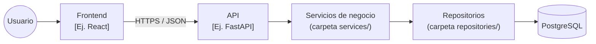
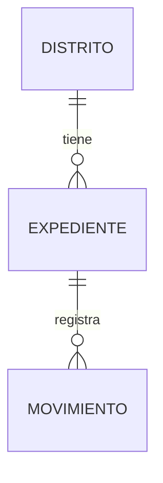
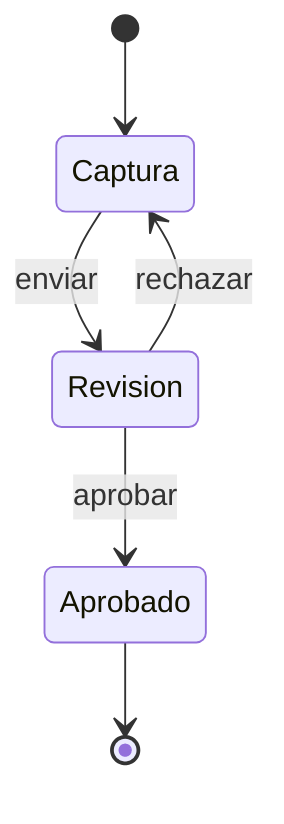
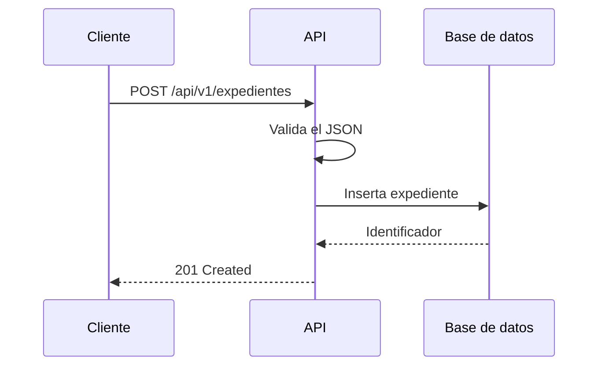

# 📚 Guía de Documentación

Esta guía define **qué** documentar, **dónde** hacerlo y **cómo** escribirlo, para que cualquier persona pueda entender el proyecto sin depender de quien lo creó.

> [!info] Basado en plantilla v1.0.0 (2026-10-29)

## 1. Principios generales 📜

- **Idioma:** español claro y neutro. Los términos técnicos en inglés van en _itálica_ (ej. _endpoint_, _token_).
- **Explica el porqué:** el código ya muestra el cómo; la documentación explica el propósito y las decisiones.
- **Sin datos sensibles:** nunca escribas contraseñas, tokens, IPs reales ni datos personales. Usa valores de ejemplo.
- **Documenta en el mismo PR:** si un cambio modifica la API, la arquitectura o una regla de negocio, su documentación se actualiza en ese mismo _Pull Request_.
- **Una sola fuente de verdad:** si algo ya está en otro documento, enlázalo en lugar de copiarlo.

## 2. Estructura de la documentación 🗂️

Todo proyecto debe tener esta estructura en su raíz:

```
proyecto/
├── README.md          # Bienvenida, instalación y ejecución
├── CONTRIBUTING.md    # Cómo contribuir
├── CHANGELOG.md       # Historial de cambios por versión
├── DEPLOY.md          # Procedimiento de despliegue
├── DOCS.md            # Este archivo: reglas de documentación
└── docs/              # Documentación técnica detallada
    ├── README.md      # Índice de toda la documentación (obligatorio)
    ├── arquitectura.md
    ├── dominio.md
    └── api/
        ├── expedientes.md
        └── distritos.md
```

- La carpeta `docs/` vive en la **raíz del proyecto**.
- El archivo `docs/README.md` es el **índice** obligatorio: enlaza y resume cada documento de `docs/`.

### Ejemplo de índice (`docs/README.md`)

```markdown
# Índice de Documentación

| Documento                              | Descripción                                  |
| -------------------------------------- | -------------------------------------------- |
| [Arquitectura](arquitectura.md)        | Componentes, capas y tecnologías del sistema |
| [Dominio](dominio.md)                  | Glosario, entidades y reglas de negocio      |
| [API: Expedientes](api/expedientes.md) | Endpoints de expedientes                     |
| [API: Distritos](api/distritos.md)     | Endpoints de distritos judiciales            |
```

## 3. Arquitectura del proyecto (`docs/arquitectura.md`)

Explica **cómo está organizado el sistema**, no cada función. Debe incluir:

1. **Propósito:** qué hace el sistema y para quién, en 2 o 3 líneas.
2. **Tecnologías:** lenguaje, _framework_, base de datos y servidor, con su versión.
3. **Capas o módulos:** qué responsabilidad tiene cada uno y en qué carpeta vive.
4. **Diagrama de componentes** en **Mermaid**.
5. **Dependencias externas:** base de datos, APIs de terceros, VPN, servicios de firma, etc.
6. **Despliegue:** en qué servidor o contenedor corre cada parte.

Ejemplo:



**Reglas:**

- Empieza con un diagrama de **contexto general** y después añade diagramas por módulo si hacen falta.
- Usa los **nombres reales** de carpetas, módulos y servicios del repositorio.

## 4. Dominio y lógica de negocio (`docs/dominio.md`) 💡

Documenta **solo el dominio**: el problema que resuelve el sistema y las reglas del negocio. No describas clases, funciones, tablas SQL ni detalles de implementación.

Debe incluir:

1. **Glosario:** términos del negocio con su definición (expediente, turno, distrito, etc.).
2. **Entidades principales** y sus relaciones (diagrama `erDiagram` o `classDiagram`).
3. **Estados y transiciones** de los elementos importantes (diagrama `stateDiagram-v2`).
4. **Procesos** paso a paso (diagrama `flowchart` o `sequenceDiagram`).
5. **Reglas de negocio** numeradas como `RN-01`, `RN-02`, etc.

### Ejemplo de relaciones



### Ejemplo de estados



### Ejemplo de reglas de negocio

| ID    | Regla                                     | Condición                  | Resultado                                       |
| ----- | ----------------------------------------- | -------------------------- | ----------------------------------------------- |
| RN-01 | Solo se aprueba un expediente en revisión | Estado actual = `Revision` | Cambia a `Aprobado` y se registra un movimiento |

**Reglas para Mermaid:**

- Pon entre comillas las etiquetas con acentos o espacios: `A["Revisión de expediente"]`.
- No uses acentos ni espacios en los identificadores de nodo; usa nombres cortos como `A`, `B` o `Revision`.
- Revisa cada diagrama en la vista previa de **GitHub** antes de subirlo.

## 5. Documentación de la API (`docs/api/`) 🚪

### 5.1 Índice de _endpoints_

Todos los _endpoints_ deben aparecer en el índice de `docs/README.md` o en una tabla propia dentro de `docs/api/`:

| Método | Ruta                  | Descripción                   | Detalle                           |
| ------ | --------------------- | ----------------------------- | --------------------------------- |
| GET    | `/api/v1/expedientes` | Lista expedientes con filtros | [Expedientes](api/expedientes.md) |
| POST   | `/api/v1/expedientes` | Crea un expediente            | [Expedientes](api/expedientes.md) |

### 5.2 Ficha de cada _endpoint_

Cada endpoint tiene su propia sección con **este orden fijo**:

````markdown
### Crear expediente

`POST /api/v1/expedientes`

Crea un expediente en estado `Captura`.

**Autenticación:** Bearer token (requerida)

**Parámetros de ruta:** ninguno

**Parámetros de consulta:** ninguno

**Entrada (JSON):**

```json
{
  "numero": "EXP-2026-0001",
  "distrito_id": 3,
  "descripcion": "Texto breve del expediente"
}
```

| Campo         | Tipo    | Requerido | Descripción                           |
| ------------- | ------- | --------- | ------------------------------------- |
| `numero`      | string  | Sí        | Número oficial. Máximo 20 caracteres. |
| `distrito_id` | integer | Sí        | Identificador del distrito.           |
| `descripcion` | string  | No        | Descripción breve.                    |

**Respuesta exitosa `201 Created`:**

```json
{
  "id": 15,
  "numero": "EXP-2026-0001",
  "estado": "Captura",
  "creado_en": "2026-10-29T14:30:00-06:00"
}
```

**Errores:**

| Código             | Cuándo ocurre                          |
| ------------------ | -------------------------------------- |
| `400 Bad Request`  | Algún campo no cumple el formato       |
| `401 Unauthorized` | Token ausente o vencido                |
| `409 Conflict`     | Ya existe un expediente con ese número |

**Ejemplo:**

```bash
curl -X POST "https://[host]/api/v1/expedientes" \
  -H "Authorization: Bearer [TOKEN]" \
  -H "Content-Type: application/json" \
  -d '{"numero": "EXP-2026-0001", "distrito_id": 3}'
```
````

### 5.3 Métodos HTTP

| Método   | Uso                                    | Éxito típico             | Lleva cuerpo |
| -------- | -------------------------------------- | ------------------------ | ------------ |
| `GET`    | Consultar. **Nunca cambia datos.**     | `200 OK`                 | No           |
| `POST`   | Crear un recurso o ejecutar una acción | `201 Created` / `200 OK` | Sí           |
| `PUT`    | Reemplazar un recurso completo         | `200 OK`                 | Sí           |
| `PATCH`  | Modificar solo algunos campos          | `200 OK`                 | Sí           |
| `DELETE` | Eliminar (preferir borrado lógico)     | `204 No Content`         | No           |

### 5.4 Nombrar rutas (_endpoints_)

1. **Versión en la ruta:** todas empiezan con `/api/v1/`.
2. **Sustantivos en plural** y minúsculas: `/expedientes`, no `/expediente` ni `/getExpedientes`.
3. **Kebab-case** para palabras compuestas: `/tipos-de-audiencia`, no `/tiposDeAudiencia`.
4. **Sin verbos en la ruta:** el método HTTP ya indica la acción. Si una acción no encaja en un CRUD, exprésala como sub-recurso con `POST`: `POST /api/v1/expedientes/{expediente_id}/aprobar`.
5. **Identificadores** entre llaves y con nombre descriptivo: `/expedientes/{expediente_id}`.
6. **Filtros, orden y paginación** van en la consulta, no en la ruta: `GET /api/v1/expedientes?estado=aprobado&page=2&page_size=20`.
7. **Máximo dos niveles de anidamiento:** `/distritos/{distrito_id}/expedientes` está bien; más profundo, usa un recurso propio con filtros.
8. **Coherencia:** el nombre del recurso debe coincidir con el nombre del módulo y de la entidad del dominio.

| No recomendado                     | Recomendado                                        |
| ---------------------------------- | -------------------------------------------------- |
| `GET /api/getExpedientes`          | `GET /api/v1/expedientes`                          |
| `POST /api/v1/expediente/crear`    | `POST /api/v1/expedientes`                         |
| `GET /api/v1/Expedientes/{ID}`     | `GET /api/v1/expedientes/{expediente_id}`          |
| `POST /api/v1/aprobarExpediente/5` | `POST /api/v1/expedientes/{expediente_id}/aprobar` |

> [!NOTE] Si el proyecto ya tiene una convención distinta, documéntala en `docs/api/README.md` y sé consistente con ella.

### 5.5 Formato de los JSON

- **Campos en `snake_case`:** `distrito_id`, no `distritoId`.
- **Fechas en ISO 8601 con zona horaria:** `2026-10-29T14:30:00-06:00`.
- **Ausencia de valor:** usa `null`, no cadenas vacías `""`.
- **Listas paginadas** con una forma fija:

```json
{
  "data": [],
  "page": 1,
  "page_size": 20,
  "total": 0
}
```

- **Errores** con una forma fija:

```json
{
  "error": "expediente_no_encontrado",
  "mensaje": "No existe un expediente con el identificador indicado."
}
```

Documenta la forma elegida una sola vez en `docs/api/README.md` y no la cambies entre _endpoints_.

### 5.6 Flujos complejos (opcional)

Cuando un proceso involucra varios componentes, muéstralo con un diagrama de secuencia:



## 6. Mantenimiento 🔨

- Si un cambio afecta la API, la arquitectura o el dominio, actualiza su documento en el mismo _Pull Request_ y registra el cambio en `CHANGELOG.md`.
- Revisa la documentación durante la revisión del PR, igual que el código.
- Antes de eliminar un _endpoint_, márcalo como **obsoleto** en el índice durante al menos una versión y anótalo en `CHANGELOG.md` (sección _Obsoleto_ y después _Eliminado_).
- Prueba los ejemplos `curl` contra el ambiente de desarrollo antes de publicarlos.

---

© 2026 Poder Judicial del Estado de Coahuila de Zaragoza.
